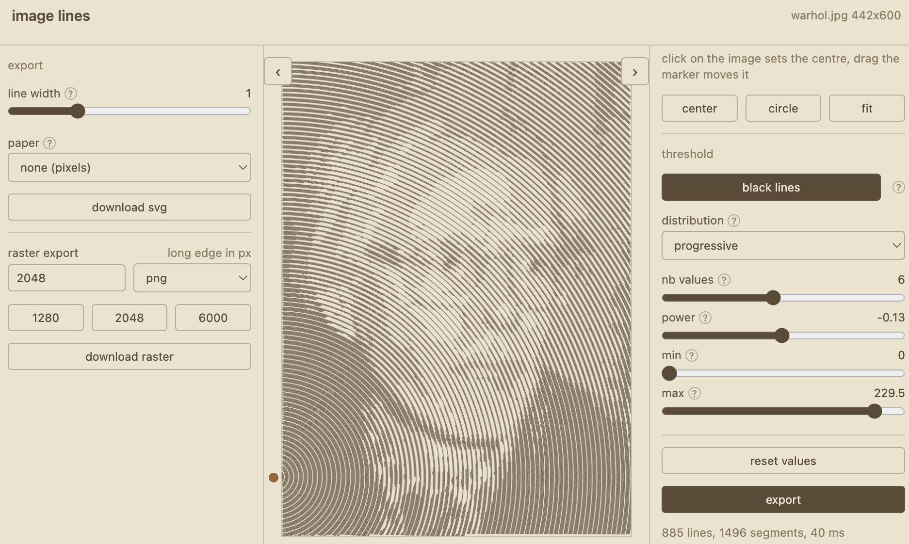

```
██╗███╗   ███╗ █████╗  ██████╗ ███████╗    ██╗     ██╗███╗   ██╗███████╗███████╗
██║████╗ ████║██╔══██╗██╔════╝ ██╔════╝    ██║     ██║████╗  ██║██╔════╝██╔════╝
██║██╔████╔██║███████║██║  ███╗█████╗      ██║     ██║██╔██╗ ██║█████╗  ███████╗
██║██║╚██╔╝██║██╔══██║██║   ██║██╔══╝      ██║     ██║██║╚██╗██║██╔══╝  ╚════██║
██║██║ ╚═╝ ██║██║  ██║╚██████╔╝███████╗    ███████╗██║██║ ╚████║███████╗███████║
╚═╝╚═╝     ╚═╝╚═╝  ╚═╝ ╚═════╝ ╚══════╝    ╚══════╝╚═╝╚═╝  ╚═══╝╚══════╝╚══════╝

  ╱╱╱╱╱╱╱╱╱╱╱╱╱╱╱╱╱╱╱╱╱╱╱╱╱╱╱╱╱╱╱╱╱╱╱╱╱╱╱╱╱╱╱╱╱╱╱╱╱╱╱╱╱╱╱╱╱╱╱╱╱╱╱╱╱╱╱╱╱╱╱╱╱╱╱╱╱╱
   ╱╱╱╱╱╱╱╱╱╱╱╱╱╱╱╱╱╱╱╱╱╱╱╱  ╱╱╱╱╱╱╱╱╱╱╱╱╱╱  ╱╱╱╱╱╱╱╱  ╱╱╱╱  ╱╱  ╱  ╱   ╱    ╱
    ╱╱╱╱╱╱╱╱╱╱╱╱╱╱╱╱╱╱╱╱  ╱╱╱╱╱╱╱╱╱╱╱╱  ╱╱╱╱╱╱╱╱  ╱╱╱╱  ╱╱  ╱  ╱   ╱    ╱     ╱
     ╱╱╱╱╱╱╱╱╱╱╱╱╱╱╱╱  ╱╱╱╱╱╱╱╱╱╱  ╱╱╱╱╱╱╱╱  ╱╱╱╱  ╱╱  ╱  ╱   ╱    ╱     ╱      ╱

  ╞════ image to hatched lines, in the browser ════╡
```

# Image Lines

Browser port of [cfloutier/image_lines](https://github.com/cfloutier/image_lines),
a Processing sketch that converts an image into a line drawing: parallel
lines, concentric circles or sine waves are sampled against pixel brightness
and only the segments above or below a set of thresholds are kept. The result
is a plotter-ready vector drawing where the image is encoded in the presence
or absence of line segments.



The port runs entirely in the browser, without server, build step or
dependencies: **[tlausz.github.io/image-lines](https://tlausz.github.io/image-lines/)**,
or open `index.html` locally. The algorithm lives in `lines.js`,
the page only handles UI and canvas.

## Usage

Drop an image anywhere on the page or use "load image"; "example" reloads
the embedded demo portrait ([Andy Warhol, 1975](https://commons.wikimedia.org/wiki/File:Andy_Warhol1975.jpg),
public domain, Wikimedia Commons). In circle mode a click on the image sets
the centre, the marker can be dragged. "export" opens the left panel with
SVG (pixel size or paper size with 10 mm margin) and PNG/WebP raster
download. Parameters follow the original names; the
[original README](https://github.com/cfloutier/image_lines#readme)
documents them in detail.

| Parameter | Role |
|-----------|------|
| `width` | Working width of the image in px; the drawing has the same size |
| `blur` | Blur radius applied before sampling |
| `levels min` / `levels max` / `levels gamma` | Input range clamp and gamma before sampling |
| `image alpha` | Shows the processed image under the lines, preview only |
| `curve type` | lines, circles or sinus |
| `direction` | Angle of the lines in degrees (lines and sinus) |
| `size` | Half-length of the lines around the image centre (lines and sinus) |
| `min radius` / `max radius` | Innermost and outermost circle; "fit" covers the image |
| `center x` / `center y` | Circle centre offset from the image centre |
| `ellipse` | 0 circle, positive wide, negative tall |
| `amplitude` / `period` | Sine wave height and wavelength |
| `lines spacing` | Distance between adjacent lines |
| `precision` | Step size along each line when sampling pixels |
| `black lines` | On: draw segments in dark areas; off: in bright areas |
| `distribution` | Threshold order across adjacent lines |
| `nb values` | Number of threshold levels |
| `power` | Curve exponent: 0 linear, > 0 packs thresholds into the dark end, < 0 into the bright end |
| `min` / `max` | Tonal range clamp before threshold evaluation |

## Settings

"save settings" downloads all parameters as JSON, "load settings" reads such
a file back. Files from the original's `Settings/` folder load as well; the
image itself is not part of a settings file.

## Tests

```
node --test
```

`test.js` covers the threshold distribution sequences, the threshold curve,
line geometry of all three modes, the segment filter, image levels and the
SVG output. No packages needed.

## License and credits

Original algorithm and Processing implementation: Copyright cfloutier,
released under the GNU Lesser General Public License 2.1 or later (see the
header of `image_lines.pde` in the original repository).

This port: Copyright 2026 TLausZ, same license, see [LICENSE](LICENSE).
